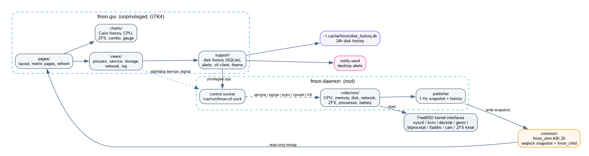
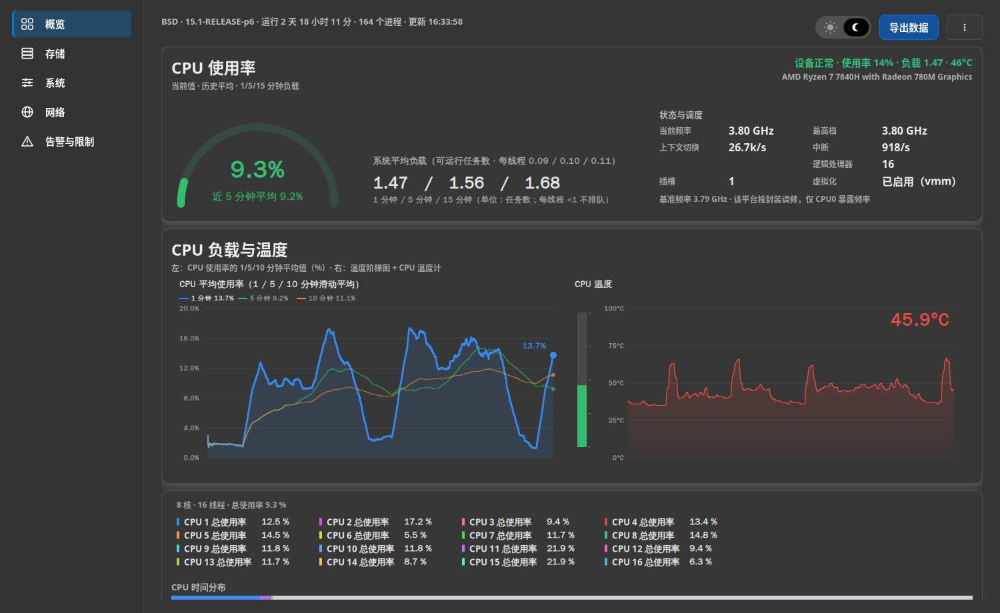
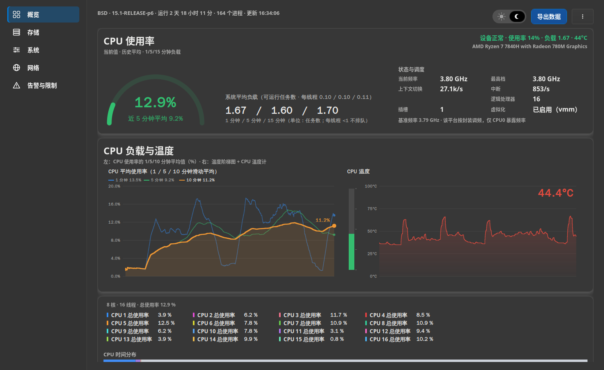
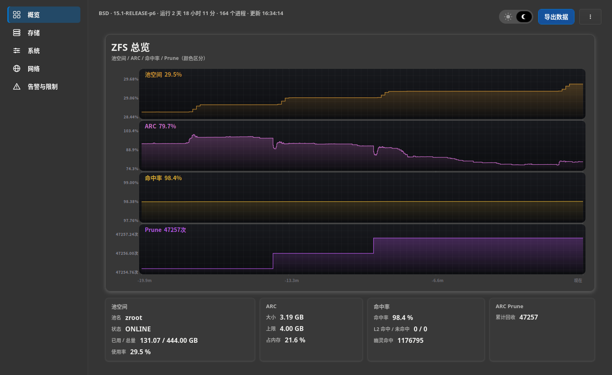
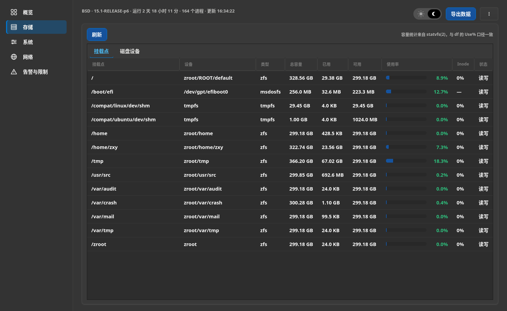
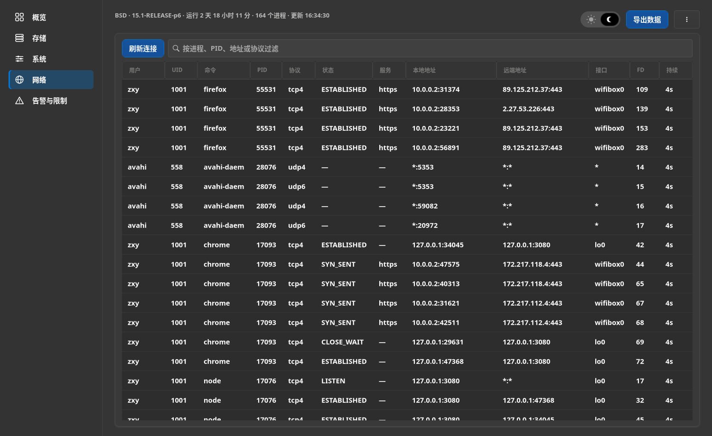
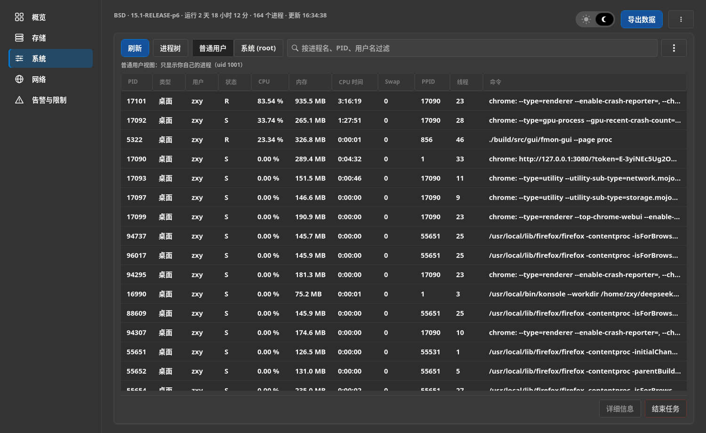
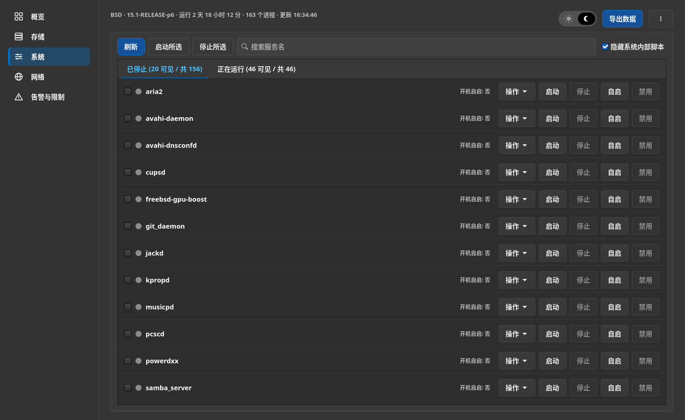
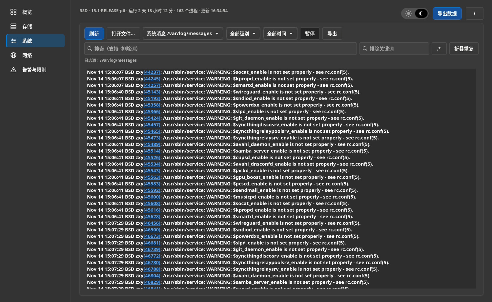
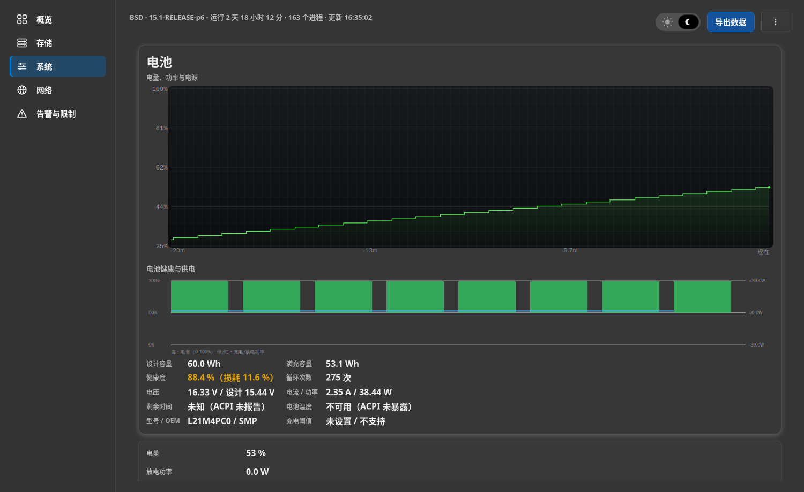

# fmon — FreeBSD System Monitor

A native FreeBSD system monitor and resource manager written in C11 with GTK4.

## Architecture

```
fmon-daemon (root)  --POSIX shared memory (seqlock)-->  fmon-gui (user)
  CPU / memory / disk / network / ZFS / processes          GTK4 + Cairo
  /var/run/fmon-ctl.sock  <---- privileged actions --------
```

- **Daemon**: samples at 1 Hz and publishes immutable snapshots through shared memory.
- **GUI**: maps shared memory read-only; a crash of the GUI never affects collection.
- **Control channel**: privileged operations (signals, services, sysrc, cpuset, rctl) are validated and executed by the root daemon over a local Unix socket. No shell interpolation.



## Screenshots

| Overview | CPU | ZFS |
|---|---|---|
|  |  |  |

<details>
<summary>More screenshots (storage, network, processes, services, logs, battery)</summary>

| Storage | Network | Processes |
|---|---|---|
|  |  |  |

| Services | Logs | Battery |
|---|---|---|
|  |  |  |

See [project structure](docs/PROJECT_STRUCTURE.md) for the current data flow and directory layout.
</details>

## Features

- CPU: total/per-core utilization, load average, frequency, temperature, thermal history.
- Memory: physical memory, swap, ARC, page/VM counters.
- Storage: disks, GEOM type/interface, USB link speed, mount points, inode/RO status.
- ZFS: pools, ARC size/hit rate/L2ARC/prune/ghost cache, per-pool I/O.
- Network: interfaces, addresses, TCP/UDP connection table with process/PID mapping.
- Processes: sortable list, tree view, multi-select batch actions, signals, nice, cpuset, open files, sockets, parent jump, CSV export.
- Services: rc.d start/stop/restart/reload (when supported), enable/disable via sysrc, status, logs, dependency tree, PID jump, batch operations.
- Logs: multiple sources (messages, auth, security, all, cron, debug, dmesg, zpool events, pkg and jail logs), level/time filters, regex, dedup, PID links, context expansion, export.
- Battery: health, design/full capacity, cycles, voltage/current, dual-axis history.
- Alerts: thresholds, desktop notifications, history, silence.

## Install from the package

```sh
sudo pkg install ./fmon-1.1.1.pkg
sudo sysrc fmon_daemon_enable=YES
sudo service fmon_daemon start
fmon-gui
```

Uninstall:

```sh
sudo service fmon_daemon stop
sudo sysrc fmon_daemon_enable=NO
sudo pkg delete fmon
```

## Build from source

```sh
meson setup build
ninja -C build
meson test -C build
sudo ./install.sh
```

Requirements: FreeBSD 15+, C11 compiler, Meson/Ninja, GTK4, Cairo, SQLite3, libdrm (optional AMD GPU sensors).

## Repository layout

- `src/daemon` — collector and root control daemon.
- `src/gui` — GTK4 interface, charts, views.
- `src/common` — shared-memory ABI and helpers.
- `tests` — unit tests (14 test suites).
- `dist/` — prebuilt FreeBSD package and source archive.
- `docs/` — additional documentation.

## License

BSD-2-Clause. See [LICENSE](LICENSE).

---
