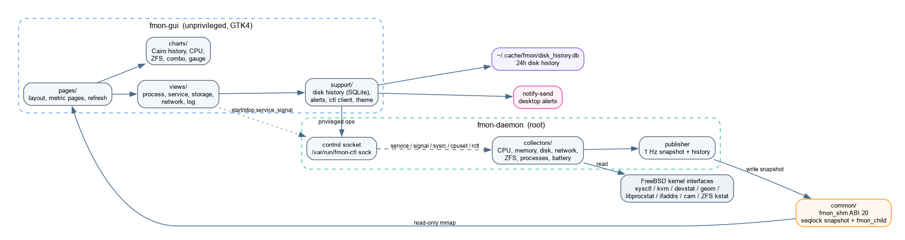
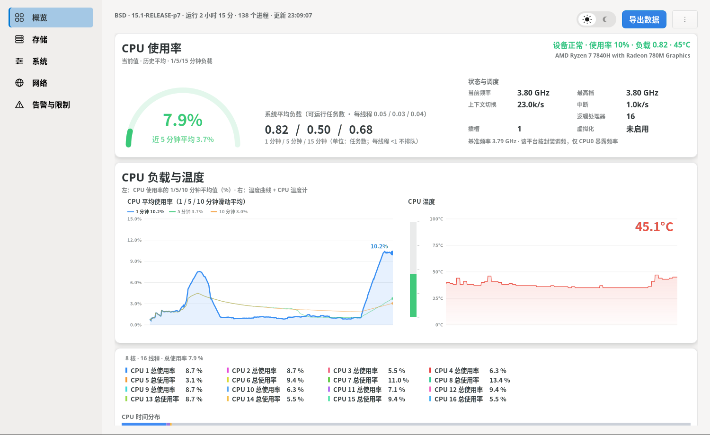

# fmon — FreeBSD System Monitor

A native FreeBSD system monitor and resource manager written in C11 with GTK4.

## What's new in 1.2.0

- **Strict provider contract**: kernel API first, FreeBSD base tools/optional dependencies only as fallback; unsupported values show `—`, never fake 0.
- **Real disk SMART**: NVMe ioctl, CAM ATA SMART, CAM SCSI LOG SENSE; multi-NVMe controller mapping; no hard dependency on nvmecontrol/smartctl.
- **Kernel disk metadata**: `DIOCG*`, NVMe controller data, CAM ATA/SCSI inquiry; speculative SSD/HDD guessing removed.
- **ABI 23 validity bits**: swap/zpool/memory modules/mounts/processes/ZFS ARC/battery distinguish real 0 from probe failure.
- **Installer and desktop integration**: auto-installs missing dmidecode/smartmontools/libdrm; custom SVG app icon and `.desktop` entry, no system icon theme required.

Full details: [1.2.0 release notes](docs/RELEASE_NOTES_1.2.0.md).

## Architecture

```
fmon-daemon (root)  --POSIX shared memory (seqlock)-->  fmon-gui (user)
  CPU / memory / disk / network / ZFS / processes          GTK4 + Cairo
  /var/run/fmon-ctl.sock  <---- privileged actions --------
```

- **Daemon**: samples at 1 Hz and publishes immutable snapshots through shared memory.
- **GUI**: maps shared memory read-only; a crash of the GUI never affects collection.
- **Control channel**: privileged operations (signals, services, sysrc, cpuset, rctl) are validated and executed by the root daemon over a local Unix socket. No shell interpolation.



## Screenshots



## Features

- CPU: total/per-core utilization, load average, frequency, temperature, thermal history.
- Memory: physical memory, swap, ARC, page/VM counters.
- Storage: disks, GEOM type/interface, USB link speed, mount points, inode/RO status.
- ZFS: pools, ARC size/hit rate/L2ARC/prune/ghost cache, per-pool I/O.
- Network: interfaces, addresses, TCP/UDP connection table with process/PID mapping.
- Processes: sortable list, tree view, multi-select batch actions, signals, nice, cpuset, open files, sockets, parent jump, CSV export.
- Services: rc.d start/stop/restart/reload (when supported), enable/disable via sysrc, status, logs, dependency tree, PID jump, batch operations.
- Logs: multiple sources (messages, auth, security, all, cron, debug, dmesg, zpool events, pkg and jail logs), level/time filters, regex, dedup, PID links, context expansion, export.
- Battery: health, design/full capacity, cycles, voltage/current, dual-axis history.
- Alerts: thresholds, desktop notifications, history, silence.

## Install from the package

```sh
sudo pkg install ./fmon-1.2.0.pkg
sudo sysrc fmon_daemon_enable=YES
sudo service fmon_daemon start
fmon-gui
```

Uninstall:

```sh
sudo service fmon_daemon stop
sudo sysrc fmon_daemon_enable=NO
sudo pkg delete fmon
```

## Build from source

```sh
meson setup build
ninja -C build
meson test -C build
sudo ./install.sh
```

Requirements: FreeBSD 15+, C11 compiler, Meson/Ninja, GTK4, Cairo, SQLite3, libdrm (optional AMD GPU sensors).

## Repository layout

- `src/daemon` — collector and root control daemon.
- `src/gui` — GTK4 interface, charts, views.
- `src/common` — shared-memory ABI and helpers.
- `tests` — unit tests (14 test suites).
- `dist/` — prebuilt FreeBSD package and source archive.
- `docs/` — additional documentation.

## License

BSD-2-Clause. See [LICENSE](LICENSE).

---

# fmon — FreeBSD 系统监控

用 C11 + GTK4 编写的 FreeBSD 原生系统监控与资源管理工具。

## 1.2.0 更新

- **严格采集契约**：内核接口优先，FreeBSD base 工具/可选依赖只做回退；无接口显示 `—`，绝不伪造 0。
- **磁盘 SMART 内核化**：NVMe ioctl、CAM ATA SMART、CAM SCSI LOG SENSE；多 NVMe 控制器反查；不硬依赖 nvmecontrol/smartctl。
- **磁盘元数据内核化**：`DIOCG*`、NVMe controller data、CAM ATA/SCSI inquiry；删除按型号/容量猜盘型。
- **ABI 23 有效位**：Swap、zpool、内存条、挂载点、进程、ZFS ARC、电池区分“真实 0”和“探测失败”。
- **安装与桌面集成**：自动补齐 dmidecode/smartmontools/libdrm；自绘 SVG 应用图标与 `.desktop` 入口，不依赖系统图标主题。

完整说明：[1.2.0 发布说明](docs/RELEASE_NOTES_1.2.0.md)。

## 架构

- **fmon-daemon（root）**：1 Hz 采集 CPU/内存/磁盘/网络/ZFS/进程，通过共享内存发布一致快照。
- **fmon-gui（普通用户）**：只读映射共享内存，GTK4 + Cairo 渲染；界面崩溃不影响采集。
- **控制通道**：结束进程、服务启停、sysrc、cpuset、rctl 等特权操作由 root daemon 校验后执行，不经过 shell。


## 界面截图


## 功能

- CPU 使用率/每核、负载、频率、温度与历史曲线；
- 内存、Swap、ARC、L2ARC、ZFS 池与命中率；
- 磁盘类型/接口/USB 速率、挂载点、Inode/只读状态；
- 网络接口与 TCP/UDP 连接表，进程/PID 映射；
- 进程排序、树形视图、多选批量操作、信号/nice/cpuset、打开文件/网络连接、跳转父进程、CSV 导出；
- rc.d 服务启停/重启/重载、自启、状态、日志、依赖树、PID 跳转、批量操作；
- 日志多源、级别/时间过滤、正则、重复折叠、PID 链接、上下文展开、导出；
- 电池健康度、设计/满充容量、循环次数、电压/电流、双轴历史；
- 阈值告警、桌面通知、告警历史、静默；
- 自绘 SVG 应用图标、导航/菜单图标与 `.desktop` 入口，不依赖桌面图标主题。

## 安装

```sh
sudo pkg install ./fmon-1.2.0.pkg
sudo sysrc fmon_daemon_enable=YES
sudo service fmon_daemon start
fmon-gui
```

卸载：

```sh
sudo service fmon_daemon stop
sudo sysrc fmon_daemon_enable=NO
sudo pkg delete fmon
```

## 从源码编译

```sh
meson setup build
ninja -C build
meson test -C build
sudo ./install.sh
```

要求：FreeBSD 15+、C11 编译器、Meson/Ninja、GTK4、Cairo、SQLite3；AMD GPU 传感器可选依赖 libdrm。
安装脚本会自动检测并安装 `dmidecode`、`smartmontools`、`libdrm`（已有则跳过，`--skip-deps` 可禁用）。

## 目录

- `src/daemon` — 采集与 root 控制守护进程；
- `src/gui` — GTK4 界面、图表、页面；
- `src/common` — 共享内存 ABI 与公共代码；
- `tests` — 14 组单元测试；
- `dist/` — 预编译 FreeBSD pkg 与源码包；
- `docs/` — 补充文档。

## 许可证

BSD-2-Clause，见 [LICENSE](LICENSE)。

## 详细文档 / Detailed docs

- [中文完整说明](README.zh-CN.md)
- [English README](README.en.md)
- [折线图设计说明（线性/缺口/保峰值）](docs/CHARTS.md)
- [硬件探测覆盖与边界](docs/HARDWARE.md)
- [全功能探测契约与审计](docs/PROBE_POLICY.md)
