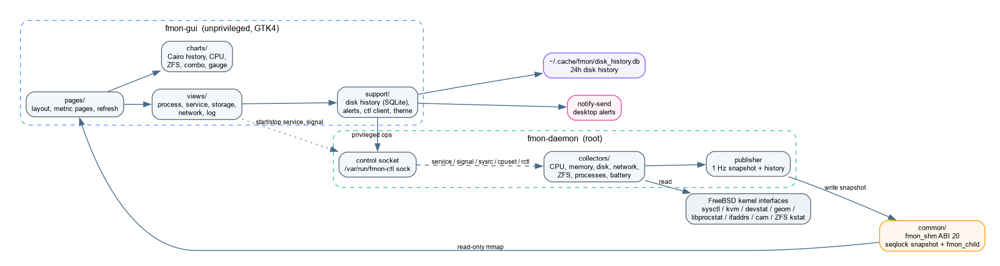
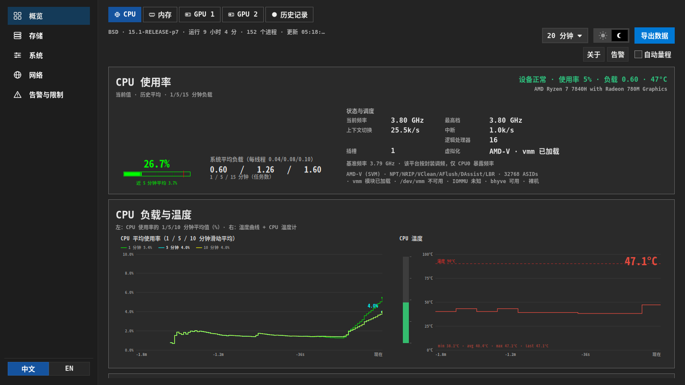
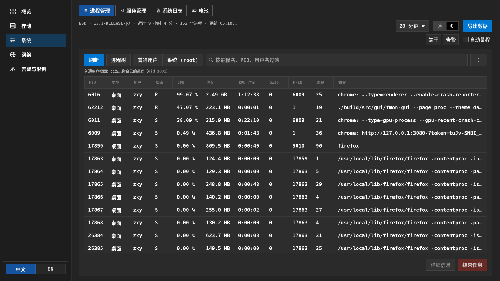
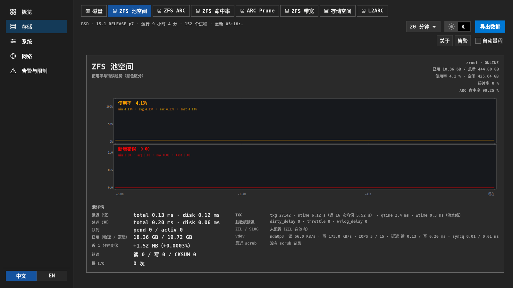
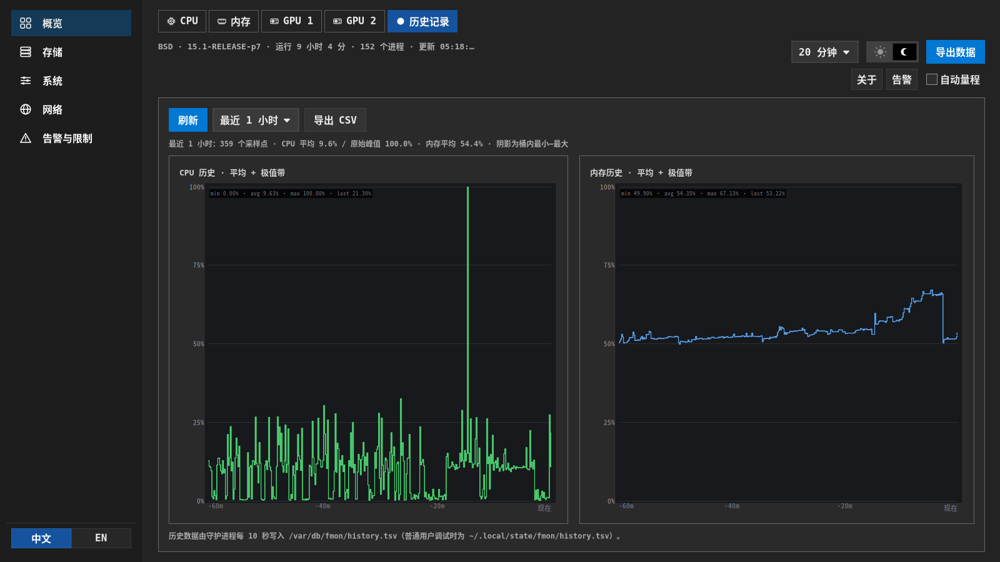

# fmon — FreeBSD 系统监控

用 C11 + GTK4 编写的 FreeBSD 原生系统监控与资源管理工具。

## 1.3.2 更新

- **中英双语**：运行时切换中文 / English，保留当前页面与主题。
- **完整网卡型号**：型号字段扩到 192 字节并整行显示；ABI 24 需 daemon/GUI 同升。
- **磁盘历史跟随设备**：只列出当前已连接磁盘，拔掉的外置盘立即从历史选择器消失。
- **窗口行为**：记住正常大小，X11 启动居中，关闭不再等待采集线程 1 秒。
- **数据真实性**：缺失指标显示 `—`，无 zpool 不再伪造 0，NaN 保持断线。
- **界面整理**：顶部页面标签、快捷操作直出、更深深色背景、浅色主题复选框修复。
- **稳定性**：进程页崩溃/右键修复，C11 模块化，20/20 测试通过。

完整说明：[1.3.2 发布说明](docs/RELEASE_NOTES_1.3.2.md)。

## 架构

- **fmon-daemon（root）**：1 Hz 采集 CPU/内存/磁盘/网络/ZFS/进程，通过共享内存发布一致快照。
- **fmon-gui（普通用户）**：只读映射共享内存，GTK4 + Cairo 渲染；界面崩溃不影响采集。
- **控制通道**：结束进程、服务启停、sysrc、cpuset、rctl 等特权操作由 root daemon 校验后执行，不经过 shell。



## 界面截图






## 功能

- CPU 使用率/每核、负载、频率、温度与历史曲线；
- 内存、Swap、ARC、L2ARC、ZFS 池与命中率；
- 磁盘类型/接口/USB 速率、挂载点、Inode/只读状态；
- 网络接口与 TCP/UDP 连接表，进程/PID 映射；
- 进程排序、树形视图、多选批量操作、信号/nice/cpuset、打开文件/网络连接、跳转父进程、CSV 导出；
- rc.d 服务启停/重启/重载、自启、状态、日志、依赖树、PID 跳转、批量操作；
- 日志多源、级别/时间过滤、正则、重复折叠、PID 链接、上下文展开、导出；
- 电池健康度、设计/满充容量、循环次数、电压/电流、双轴历史；
- 阈值告警、桌面通知、告警历史、静默；
- 自绘 SVG 应用图标、导航/菜单图标与 `.desktop` 入口，不依赖桌面图标主题。

## 安装

```sh
sudo pkg install ./fmon-1.3.2.pkg
sudo sysrc fmon_daemon_enable=YES
sudo service fmon_daemon start
fmon-gui
```

卸载：

```sh
sudo service fmon_daemon stop
sudo sysrc fmon_daemon_enable=NO
sudo pkg delete fmon
```

## 从源码编译

```sh
meson setup build
ninja -C build
meson test -C build
sudo ./install.sh
```

要求：FreeBSD 15+、C11 编译器、Meson/Ninja、GTK4、Cairo、SQLite3；AMD GPU 传感器可选依赖 libdrm。
安装脚本会自动检测并安装 `dmidecode`、`smartmontools`、`libdrm`（已有则跳过，`--skip-deps` 可禁用）。

## 目录

- `src/daemon` — 采集与 root 控制守护进程；
- `src/gui` — GTK4 界面、图表、页面；
- `src/common` — 共享内存 ABI 与公共代码；
- `tests` — 14 组单元测试；
- `dist/` — 预编译 FreeBSD pkg 与源码包；
- `docs/` — 补充文档。

## 许可证

BSD-2-Clause，见 [LICENSE](LICENSE)。

## 详细文档 / Detailed docs

- [中文完整说明](README.zh-CN.md)
- [English README](README.en.md)
- [折线图设计说明（线性/缺口/保峰值）](docs/CHARTS.md)
- [硬件探测覆盖与边界](docs/HARDWARE.md)
- [全功能探测契约与审计](docs/PROBE_POLICY.md)
