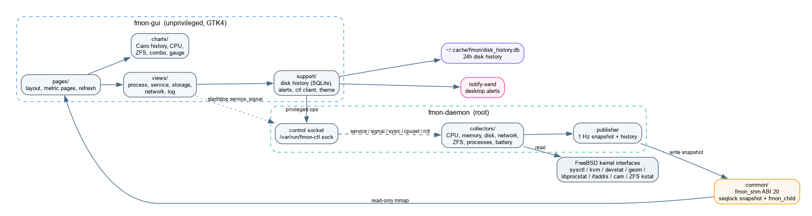

# fmon 项目结构 / Project Structure



## 目录 / Directory layout

```
fmon-1.3.0/
├── src/
│   ├── common/           共享内存 ABI、子进程执行
│   │   ├── fmon_shm.c/h
│   │   └── fmon_child.c/h
│   ├── daemon/           root 采集与控制守护进程
│   │   ├── core/         main、publisher、控制通道、告警
│   │   ├── collectors/   CPU/内存/磁盘/网络/ZFS/进程/电池采集
│   │   └── ...
│   └── gui/              GTK4 图形界面
│       ├── app/          主窗口、导航、主题、启动
│       ├── pages/        页面装配、刷新、指标卡片
│       ├── charts/       Cairo 历史曲线、仪表盘、组合图
│       ├── views/        进程/服务/存储/网络/日志/ZFS 页面
│       ├── support/      磁盘历史 SQLite、控制通道、告警、cpuset
│       └── assets/       图标与 gresource
├── tests/                14 组单元测试
├── rc.d/                 fmon_daemon rc.d 模板
├── packaging/            pkg manifest 与文件列表
├── docs/                 截图、架构图与补充文档
├── dist/                 预编译 pkg 与源码包
├── meson.build
├── install.sh
└── README.md / README.zh-CN.md / README.en.md
```

## 数据流 / Data flow

1. `fmon-daemon` 以 root 运行，1 Hz 采样：
   - `sysctl`、`kvm`、`devstat`、`geom`、`libprocstat`、
     `getifaddrs`、`cam`、ZFS kstat；
2. 采集结果写入 `/fmon_daemon_shm_v23` 的 seqlock 快照；
3. `fmon-gui` 只读 mmap，拷贝一致快照后交给 GTK/Cairo 渲染；
4. 特权操作通过 `/var/run/fmon-ctl.sock`：
   - 结束/暂停进程、nice、cpuset、rctl；
   - 服务 start/stop/restart/reload、sysrc；
5. 磁盘历史写入 `~/.cache/fmon/disk_history.db`（SQLite，7 天）；
6. 告警通过 `notify-send` 发送，并写入告警历史。

## 关键约定 / Key contracts

- 共享内存布局变更必须提升 ABI 并重命名 SHM；
- GUI 不直接提权；控制通道由 daemon 校验 pid、信号、服务名、nice、CPU mask；
- 采集线程只写、界面只读，GUI 崩溃不影响 daemon；
- 所有特权子进程使用 argv 直传，不经过 shell。
